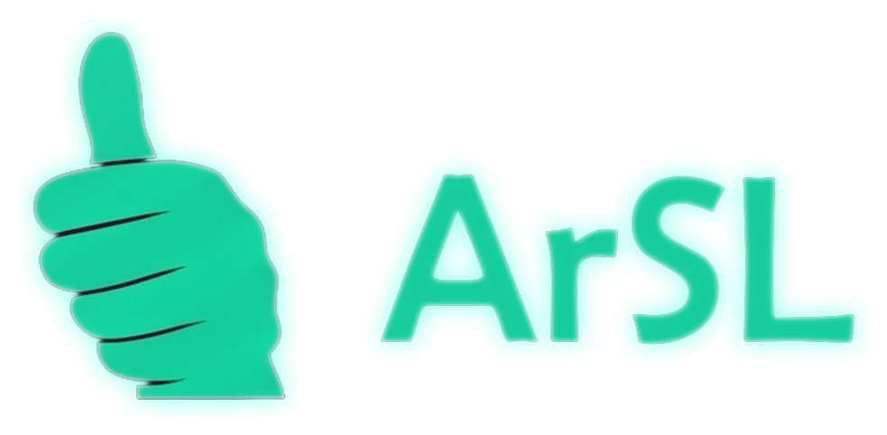
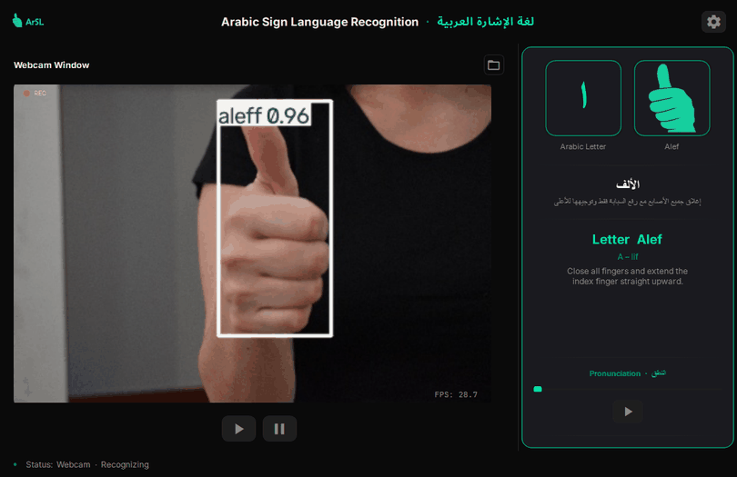
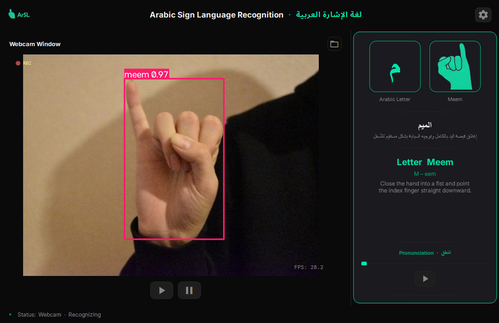
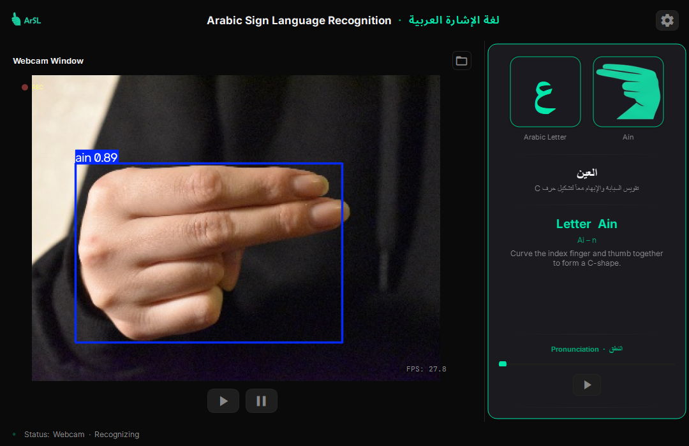
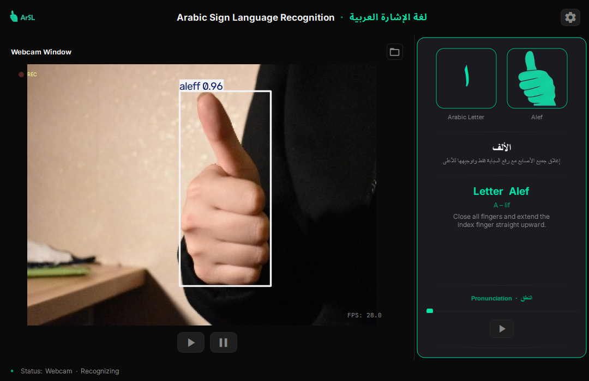
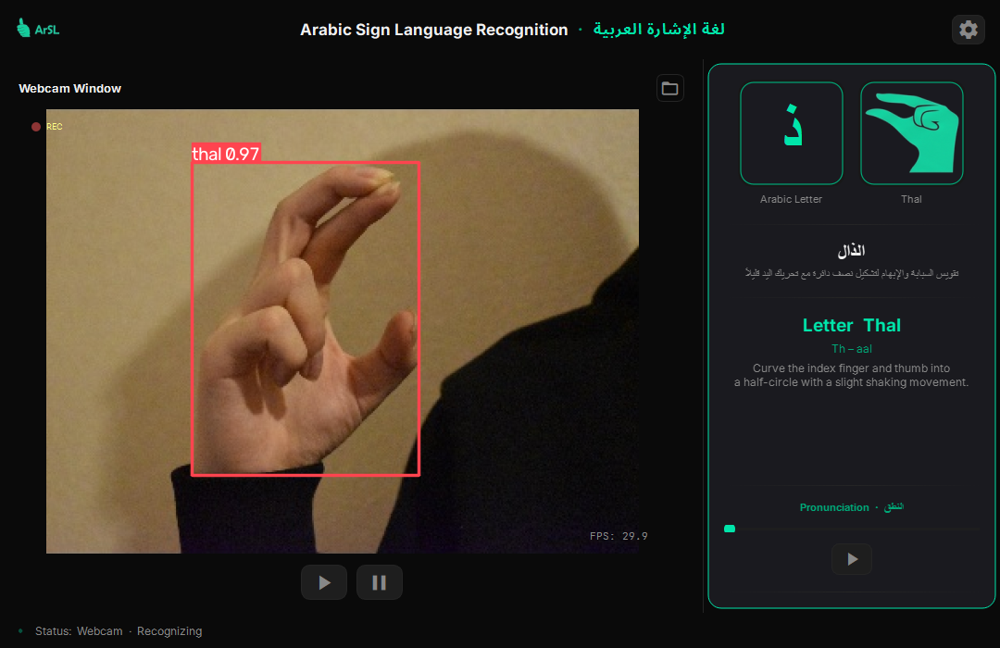
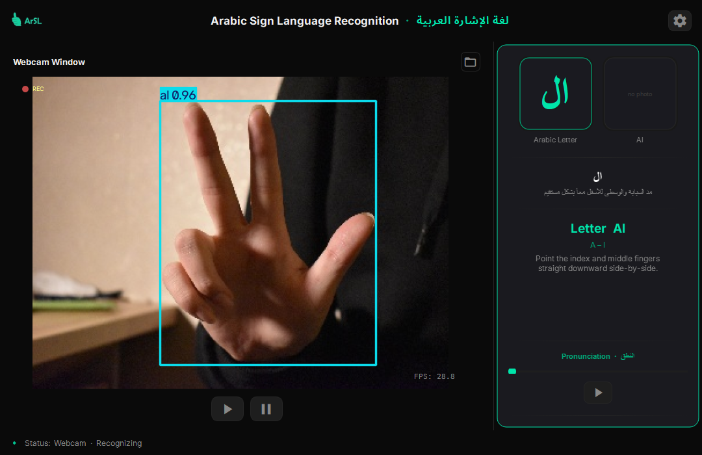
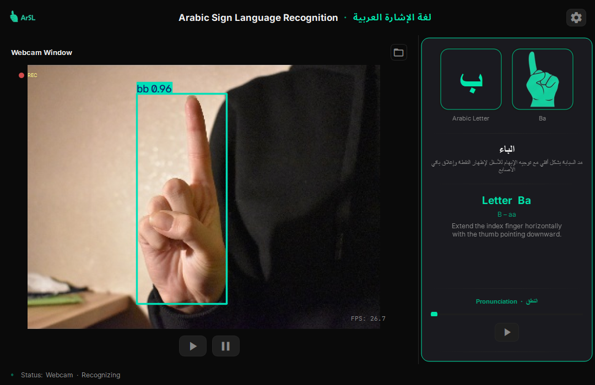
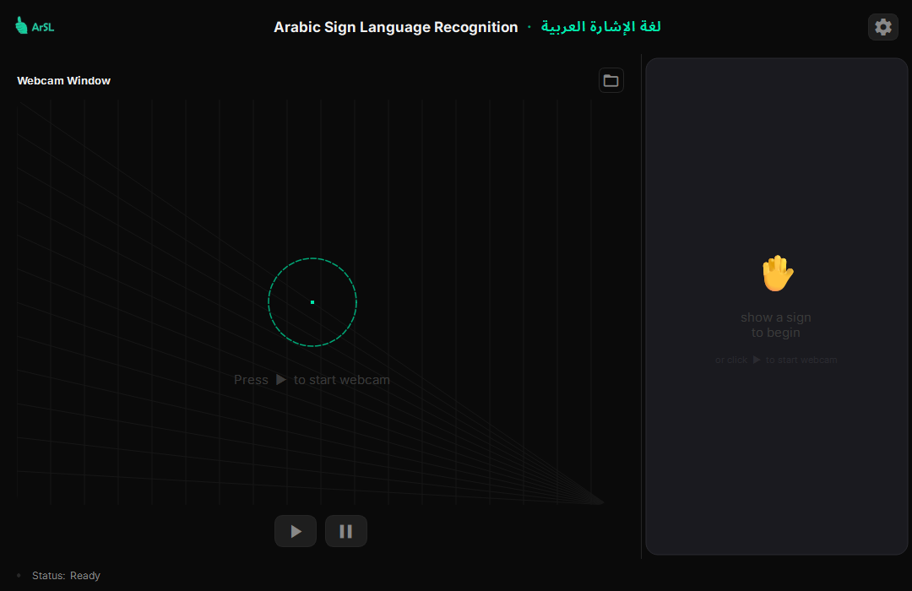

<div align="center">



**Real-time Arabic Sign Language letter recognition, powered by YOLO26.**

       



[Features](#features) • [Screenshots](#screenshots) • [Installation](#installation) • [Usage](#usage) • [Specifications](#specifications) • [Documentation](#documentation)

</div>

ArSL Recognition reads Arabic Sign Language letters from a webcam or a photo. A YOLO26 detector, trained on 32 letter signs, finds the hand and classifies the letter in real time. A side panel then shows the Arabic letter, a reference hand sign, descriptions in Arabic and English, and its pronunciation.

## Features

| Feature | Description |
|---|---|
| **Live Recognition** | Detects signs from the webcam in real time, with bounding boxes, confidence scores and an FPS counter |
| **32 Letters** | Covers the full Arabic alphabet, plus ال, لا and ة |
| **Image Upload** | Recognizes a sign in a single photo (JPG, PNG, BMP or WebP) |
| **Letter Panel** | Shows the Arabic letter, a reference hand sign, and Arabic and English names and descriptions |
| **Pronunciation** | Hold a sign for 1.5 seconds to hear the letter, or press play at any time |
| **Bilingual UI** | Dark interface with Arabic and English text, using Noto Sans Arabic and Inter |
| **GPU or CPU** | Runs on an NVIDIA GPU (~60+ FPS) or on the CPU (~15–30 FPS) |
| **Camera Select** | Choose between connected cameras in Settings |

## Screenshots

<div align="center">

| Meem (م) | Ain (ع) |
|:---:|:---:|
|  |  |
| <sub>[`1003_19_F_meem_0.jpg`](docs/samples/1003_19_F_meem_0.jpg) · confidence 0.97</sub> | <sub>[`1003_19_F_ain_0.jpg`](docs/samples/1003_19_F_ain_0.jpg) · confidence 0.89</sub> |
| **Alef (ا)** | **Thal (ذ)** |
|  |  |
| <sub>[`1003_19_F_aleff_0.jpg`](docs/samples/1003_19_F_aleff_0.jpg) · confidence 0.96</sub> | <sub>[`1003_19_F_thal_0.jpg`](docs/samples/1003_19_F_thal_0.jpg) · confidence 0.97</sub> |

<br>

| Al (ال) | Ba (ب) |
|:---:|:---:|
|  |  |
| <sub>[`1003_19_F_al_0.jpg`](docs/samples/1003_19_F_al_0.jpg) · confidence 0.96</sub> | <sub>[`1003_19_F_bb_0.jpg`](docs/samples/1003_19_F_bb_0.jpg) · confidence 0.96</sub> |

</div>

> [!NOTE]
> These screenshots use **test photos, not live webcam captures**. Each photo was shown to the app in place of a webcam frame, and the predictions and confidence scores are the model's real output.
> The photos come from the validation split of [**ArSL21L: Arabic Sign Language Letter Dataset**](https://data.mendeley.com/datasets/8hrn3bvdvk/1)
> by Batnasan, Gochoo, Otgonbold, Alnajjar and Shih (United Arab Emirates University), licensed under [CC BY 4.0](https://creativecommons.org/licenses/by/4.0/).
> All of them were taken by **signer `1003_19`** and can be found in the dataset's `data.zip` under `data/sign_data/images/1003_19_F_*.jpg`.
> Full source paths and the citation are in [DATASET.md](docs/DATASET.md).

<div align="center">

**Idle**: before the webcam starts



</div>

## Installation

Requires **Python 3.12 or newer**. An NVIDIA GPU is recommended. To run on the CPU, see [Configuration](docs/CONFIGURATION.md#cpu-or-gpu).

**With uv** (recommended: installs the exact locked versions, including CUDA PyTorch)

```bash
git clone https://github.com/nullMuath/ArSL-Recognition.git
cd ArSL-Recognition
uv sync
uv run python App.py
```

**With pip**

```bash
git clone https://github.com/nullMuath/ArSL-Recognition.git
cd ArSL-Recognition
pip install ultralytics PySide6 opencv-python
python App.py
```

The trained weights are included in the repository, so no training is needed.

## Usage

1. Press **▶** to start the webcam. To pick a different camera, open **Settings** (gear icon) first.
2. Show a letter sign to the camera. The detected letter appears in the side panel.
3. Hold the sign for **1.5 seconds** to hear its pronunciation, or press play in the panel.
4. Press **⏸** to stop the webcam.
5. To recognize a photo instead, click the **folder** button and choose an image.

## Specifications

| | |
|---|---|
| **Model** | YOLO26s (Ultralytics), ~22M parameters, 640 × 640 input |
| **Dataset** | [ArSL21L](https://data.mendeley.com/datasets/8hrn3bvdvk/1): 32 Arabic letter signs, YOLO bounding-box labels |
| **Training** | 50 epochs, batch size 16 |
| **Accuracy** | 96.7% mAP@50, 83.6% mAP@50–95, 96.3% precision, 95.5% recall |
| **Inference** | Confidence threshold 0.45, NVIDIA GPU or CPU |
| **Weights** | `runs/train/arsl21l/weights/best.pt` |
| **Tech stack** | Python 3.12, PyTorch, Ultralytics, OpenCV, PySide6 |

## Documentation

- [Architecture](docs/ARCHITECTURE.md): project layout, the recognition pipeline, threading and the letter panel
- [Configuration](docs/CONFIGURATION.md): settings, CPU or GPU, adding letters and building the Windows executable
- [Training](docs/TRAINING.md): the model, training setup, results and how to retrain
- [Dataset](docs/DATASET.md): ArSL21L, its citation and the exact sources of the README photos

---

## License

All rights reserved © 2026 nullMuath
