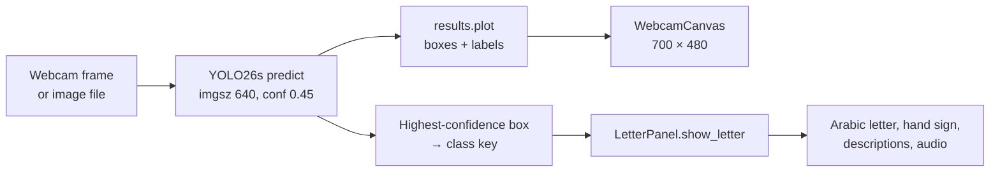

# Architecture

A technical reference for how ArSL Recognition is built: project layout, the recognition pipeline, threading and the letter panel. For setup and usage, see the [README](../README.md).

## Contents

- [Project layout](#project-layout)
- [Startup](#startup)
- [Recognition pipeline](#recognition-pipeline)
- [Threading model](#threading-model)
- [Letter panel and audio](#letter-panel-and-audio)
- [Classes](#classes)
- [Command-line tools](#command-line-tools)

---

## Project layout

```
ArSL-Recognition/
├── App.py                         # PySide6 GUI: window, inference threads, letter panel
├── App.spec                       # PyInstaller build spec
├── pyproject.toml / uv.lock       # Dependencies (Python 3.12+)
├── config/data.yaml               # YOLO dataset config: 32 class names, train/val lists
├── runs/train/arsl21l/
│   ├── weights/best.pt            # Trained model loaded by the app
│   ├── args.yaml                  # Full training arguments
│   └── results.csv, *.png         # Metrics, curves, confusion matrices
├── hand_signs/{key}_arsl.png      # Reference hand-sign illustrations
├── assets/
│   ├── sounds/{key}_arsl.mp3      # Pronunciation audio, one per letter
│   ├── fonts/                     # Inter, Material Icons, Noto Sans Arabic
│   └── logo.png, icon.png
└── src/
    ├── train.py                   # Training script
    ├── detect_webcam.py           # OpenCV webcam detector (no GUI)
    ├── detect_image.py            # Single-image detector
    ├── detect_video.py            # Video-file detector
    └── LettersGenerator.py        # Generates the pronunciation MP3s with gTTS
```

---

## Startup

`main()` in `App.py`:

1. Creates the `QApplication` with the Fusion style.
2. Loads fonts from `assets/fonts/`: Inter for UI text, Material Icons for button glyphs and Noto Sans Arabic (`NotoSansArabic-Black.ttf`) for Arabic text. If a font is missing, it tries to download it from Google Fonts and otherwise falls back to Segoe UI.
3. Applies the dark palette and builds `ArSLMainWindow` (fixed at 1080 × 700).
4. `_load_model()` loads `runs/train/arsl21l/weights/best.pt` through `ultralytics.YOLO`. If the weights are missing or fail to load, an error dialog is shown and the play, pause and upload buttons are disabled.

---

## Recognition pipeline



For every frame:

1. `model.predict(frame, imgsz=IMG_SIZE, conf=CONF, device=DEVICE)` runs detection.
2. `results[0].plot()` draws the bounding boxes and confidence labels. The frame is converted from BGR to RGB, wrapped in a `QImage` and scaled to fit the 700 × 480 canvas while keeping its aspect ratio.
3. If any boxes were found, the box with the highest confidence wins and its class name (for example `meem`) is sent to the letter panel.
4. FPS is measured as `1 / (time since the previous frame)` and drawn in the corner of the canvas.

Image upload follows the same path once, on a single file chosen with the folder button.

---

## Threading model

Inference never runs on the UI thread.

| Thread | Class | Signals |
|---|---|---|
| Webcam | `WebcamThread(QThread)` | `frame_ready(QPixmap)`, `detection(str)`, `fps_signal(float)`, `error(str)` |
| Image | `ImageInferenceThread(QThread)` | `done(QPixmap, str)`, `error(str)` |

- `WebcamThread` opens `cv2.VideoCapture(cam_index)` and loops until `stop()` clears its running flag. `stop()` waits up to 3 seconds for the thread to finish.
- Starting the webcam or loading an image first stops any running thread, so only one source is active at a time.
- Closing the window stops all threads and the audio player.

---

## Letter panel and audio

`LetterPanel` shows the detected letter:

| Element | Source |
|---|---|
| Arabic letter tile | Rendered from `LETTER_DATA[key]["arabic"]` |
| Hand-sign tile | `hand_signs/{key}_arsl.png`, or a placeholder if missing |
| Arabic name and description | `name_ar`, `desc_ar` |
| English name, pronunciation and description | `name_en`, `phonetic`, `desc_en` |
| Audio | `assets/sounds/{key}_arsl.wav`, `.mp3` or `.ogg`, played with `QMediaPlayer` |

**Transitions.** When the detected letter changes, the panel fades out (140 ms), swaps its content and fades back in (220 ms). If another letter arrives during the animation, it is queued and shown when the animation ends.

**Hold to hear.** In webcam mode, once the same letter has been detected continuously for **1.5 seconds**, its pronunciation plays automatically, once per hold. Uploaded images don't auto-play. The play button and seek slider are always available.

---

## Classes

The model predicts 32 classes. The keys are the YOLO class names used across the code, the sounds and the hand-sign images.

| Key | Letter | Key | Letter | Key | Letter | Key | Letter |
|---|:---:|---|:---:|---|:---:|---|:---:|
| `aleff` | ا | `dhad` | ض | `kaaf` | ك | `taa` | ط |
| `al` | ال | `fa` | ف | `khaa` | خ | `thaa` | ث |
| `ain` | ع | `gaaf` | ق | `la` | لا | `thal` | ذ |
| `bb` | ب | `ghain` | غ | `laam` | ل | `toot` | ة |
| `dal` | د | `ha` | ه | `meem` | م | `waw` | و |
| `dha` | ظ | `haa` | ح | `nun` | ن | `ya` | ي |
| `jeem` | ج | `saad` | ص | `ra` | ر | `yaa` | ى |
| `seen` | س | `sheen` | ش | `ta` | ت | `zay` | ز |

---

## Command-line tools

The scripts in `src/` use the same weights without the GUI:

```bash
python src/detect_webcam.py                          # live OpenCV window, press Q to quit
python src/detect_image.py --image path/to/photo.jpg
python src/detect_video.py --video path/to/clip.mp4
```

`detect_image.py` and `detect_video.py` use a confidence threshold of `0.4`, slightly lower than the GUI's `0.45`.
